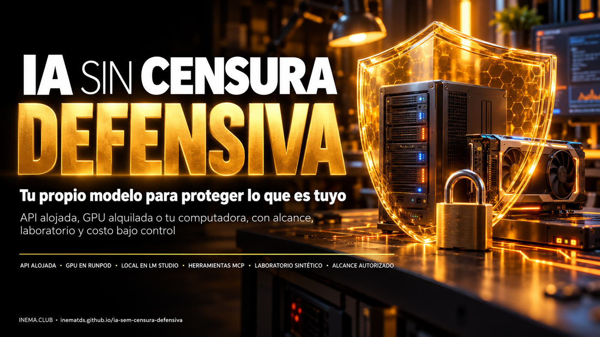

# IA sin censura, bien utilizada — tu propio modelo para seguridad defensiva

[](https://inematds.github.io/ia-sem-censura-defensiva/guia/es/)

**🇧🇷 [Português](README.md) · 🇺🇸 [English](README.en.md) · 🇪🇸 [Español](README.es.md)**

## Qué es

Este es un kit gratuito de INEMA, en portugués, para quienes estudian seguridad y quieren un modelo de IA abierto que no rechace preguntas técnicas: los llamados modelos *abliterated*, a los que se les eliminó el rechazo. Muestra cómo conectar este modelo a DeepSeek Harness (un agente de código abierto) mediante una API, una GPU alquilada en RunPod o LM Studio en tu computadora. Incluye prompts listos, scripts que comprueban si funcionan el texto, las herramientas y las imágenes, un laboratorio ficticio para practicar y una protección que detiene la GPU cuando está inactiva. Necesitas un asistente que lea archivos, Python 3.10+ y, según la ruta, una cuenta de API o de GPU, además de permiso para todo lo que vayas a probar.

## 📖 Guía de uso

Guía completa (landing + paso a paso): **https://inematds.github.io/ia-sem-censura-defensiva/guia/es/**

## ⚠️ Uso defensivo

**Solo sistemas tuyos o para los que tengas permiso por escrito de su propietario.** Registra el alcance antes de la primera solicitud, empieza por el laboratorio sintético, realiza comprobaciones no destructivas y usa pruebas proporcionales. Mantén las credenciales fuera del chat y de git. El modelo descargado se ejecuta primero sin herramientas; el aislamiento depende del sistema operativo y del contenedor: un prompt no es una barrera. Usa el endpoint local solo en `127.0.0.1`; protege siempre con autenticación el endpoint en la nube. En RunPod, detén el Pod y comprueba que aparezca **EXITED**: el almacenamiento sigue generando cargos. Reglas completas en [`kit/USO-DEFENSIVO.md`](kit/USO-DEFENSIVO.md) (en portugués).

## Las tres rutas

| Ruta | Adecuada para | Pagas | Prompts |
|---|---|---|---|
| API alojada (p. ej., Abliteration, OrcaRouter) | empezar rápido, sin GPU | uso de la API | 01 → 02 → 03 → 09 |
| GPU alquilada en RunPod | elegir el modelo y el runtime | hora de GPU + almacenamiento | 01 → 04 → 05 → 06 → 03 → 09 |
| Local en LM Studio | computadora con memoria disponible | electricidad, disco, tiempo | 01 → 07 → 08 → 03 → 09 |

Modelos de ejemplo (verificados el 26/10/2026; pueden cambiar): local **Huihui Qwen3.6 35B-A3B abliterated GGUF Q4_K** (~21,7 GB + proyector de visión de ~0,9 GB); nube **Huihui Qwen3.5 9B abliterated Q6_K** con proyector de visión.

## El proceso, de principio a fin

Quién participa: 🧠 tú en una sesión con el asistente · ⚙️ script del kit · 🤖 agente/modelo.

| # | Paso | Comando / archivo | Quién participa |
|---|---|---|---|
| 1 | Leer las reglas | [`kit/USO-DEFENSIVO.md`](kit/USO-DEFENSIVO.md) (en portugués) | 🧠 |
| 2 | Comprobar la computadora | `python3 kit/scripts/doutor.py` | ⚙️ |
| 3 | Ejecutar las pruebas offline | `python3 -m unittest discover -s kit/testes -v` | ⚙️ |
| 4 | Laboratorio + comprobación del alcance | `python3 kit/scripts/laboratorio.py` y `python3 kit/scripts/checagem_segura.py --lab-local-autorizado` | ⚙️ |
| 5 | Corregir y volver a probar | `laboratorio.py --corrigido` + la misma comprobación → `"achados": []` | ⚙️ |
| 6 | Elegir la ruta | [`kit/guias/1-escolha-da-rota.md`](kit/guias/1-escolha-da-rota.md) (en portugués) | 🧠 |
| 7 | Entregar el kit al asistente | solicitud de [`kit/CONFIGURA-COM-ASSISTENTE.md`](kit/CONFIGURA-COM-ASSISTENTE.md) (en portugués) | 🧠 → 🤖 |
| 8 | Instalar/conectar el modelo según la ruta | prompts 01, 02 / 04-05 / 07-08 en [`kit/prompts/`](kit/prompts/) (costos aprobados siempre de antemano) | 🤖, aprobado por 🧠 |
| 9 | Comprobar texto, función e imagen | `python3 kit/scripts/checa_endpoint.py --base-url ... --modelo ... --funcao --imagem kit/exemplos/teste-visao.png` | ⚙️ |
| 10 | Añadir herramientas (Playwright, Firecrawl, Nuclei) | prompt 03 + `kit/config/dsh-mcp.exemplo.yml` + `kit/exemplos/nuclei-cabecalhos-lab.yaml` solo en el laboratorio | 🤖, revisado por 🧠 |
| 11 | RunPod: protección contra inactividad | `python3 kit/scripts/guarda_ociosa.py --upstream ... --ocioso 900` (simulación → parada real con ID y nombre) | ⚙️ + 🧠 comprueba EXITED |
| 12 | Tu app, con el alcance por escrito | prompt 09 + copia completada de `kit/exemplos/escopo-autorizado.exemplo.json` | 🧠 → 🤖 |

### Dónde están la guía y el video de este repositorio

| Elemento | Ubicación | Quién participa |
|---|---|---|
| Guía (PT/EN/ES) | `guia/index.html`, `guia/en/`, `guia/es/` → https://inematds.github.io/ia-sem-censura-defensiva/guia/es/ | 🧠 sesión INEMA → ⚙️ GitHub Pages mediante Actions |
| Video explicativo | MP4 fuera del repo; release `video-v1.0.0` + reproductor en `videos/` → https://inematds.github.io/ia-sem-censura-defensiva/videos/ | ⚙️ `python3 scripts/publica.py` |

## Estructura

```
kit/
├── COMECE-AQUI.md · USO-DEFENSIVO.md · CONFIGURA-COM-ASSISTENTE.md
├── guia-rapido.pdf  el kit entero en PDF para leer e imprimir, en portugués (`python3 scripts/gera_pdf.py` lo rehace)
├── prompts/      01..09 (cada uno con el bloque FRONTEIRAS) + TODOS-OS-PROMPTS.md
├── guias/        1 escolha da rota · 2 hospedada · 3 runpod · 4 local · 5 ferramentas
│                 6 segurança do modelo · 7 custo runpod · 8 problemas comuns
├── config/       .env.exemplo · campos-do-provedor.json · dsh-mcp.exemplo.yml · mcp.exemplo.json · modelos-de-exemplo.json
├── scripts/      doutor · checa_endpoint · laboratorio · checagem_segura · guarda_ociosa · comum · gera_imagem_teste
├── testes/       test_kit.py (offline, 127.0.0.1)
├── exemplos/     escopo de exemplo · relatório de achados · template Nuclei passivo · teste-visao.png
└── verificacao/  STATUS.md · checklist.md
guia/       página de uso (PT, en/, es/)
videos/     reproductor del video explicativo
scripts/    publica.py (sube el video como release y genera el reproductor)
```

## Estado (26/10/2026)

- **Probado por INEMA:** las 25 pruebas offline de los scripts y el ciclo laboratorio → hallazgo → corrección por línea de comandos.
- **Observado, no repetido en esta versión:** modelo local Q4_K en LM Studio — texto ✔, función ✔, **imagen ✘** en ese runtime.
- **No probado:** proveedor de pago, GPU en RunPod, parada real de Pod, Harness/MCPs/Nuclei instalados. Depende de tu cuenta.

Detalles en [`kit/verificacao/STATUS.md`](kit/verificacao/STATUS.md) (en portugués). Nada de esto constituye una certificación de seguridad.

## Licencia

[MIT](LICENSE) — texto, prompts, scripts y ejemplos de INEMA. DeepSeek Harness, LM Studio, RunPod, Nuclei, Playwright, Firecrawl y los modelos mencionados pertenecen a sus autores y se rigen por sus propios términos.

---

Contenido abierto y gratuito de **[INEMA.CLUB](https://inema.club)**.